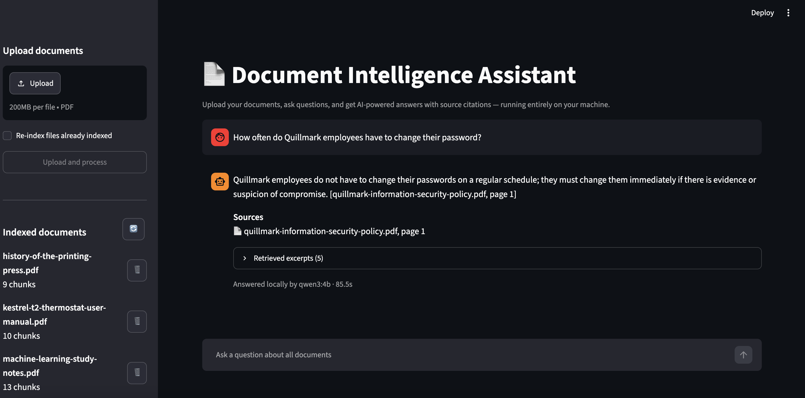
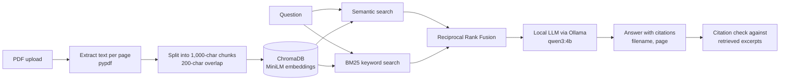

# Local RAG Document Assistant

Upload your documents, ask questions, and get AI-powered answers with source citations — running entirely on your machine.

Everything is local: PDF parsing, embeddings, search and answer generation. No API keys, cloud services or subscriptions are needed.



## How it works



## Features

- **PDF upload and indexing**: upload several PDFs at once. Each is split into page-aware chunks and stored in a local, persistent ChromaDB database. Files that are already indexed are skipped automatically.
- **Hybrid search**: semantic search (all-MiniLM-L6-v2 embeddings) and keyword search (BM25), combined with Reciprocal Rank Fusion. It finds both paraphrases and exact terms such as IDs, names and numbers.
- **Grounded answers**: a local LLM (`qwen3:4b` via Ollama) answers only from the retrieved excerpts and cites them as `[filename, page X]`. When the documents don't contain the answer, it says so.
- **Citation checking**: every citation is checked against the excerpts the model was actually given. Citations that don't match anything are flagged as unverified.
- **Transparency**: each answer shows its sources and an expandable list of the excerpts used, with similarity scores.
- **Document management**: list, filter by, and delete indexed documents.
- **System status**: Ollama, model and database health, plus document and chunk counts.

## Requirements

- macOS, Linux or Windows; tested on an Apple M2 with 8 GB RAM
- Python 3.12
- [Ollama](https://ollama.com) with the `qwen3:4b` model (about 2.5 GB on disk)

## Installation

```bash
git clone https://github.com/maheshkarthik/local-rag-document-assistant.git
cd local-rag-document-assistant

# 1. Create and activate a virtual environment
python3.12 -m venv .venv
source .venv/bin/activate

# 2. Install Python dependencies
pip install -r requirements.txt

# 3. Install Ollama (https://ollama.com/download), then download the model
ollama pull qwen3:4b
```

The first time the app starts, ChromaDB downloads its embedding model (about 80 MB) to `~/.cache/chroma`. After that the app works offline.

## Running the app

1. Make sure Ollama is running: open the Ollama app, or run `ollama serve` in a terminal.
2. Start the app from the project folder:

   ```bash
   .venv/bin/streamlit run app.py
   ```

3. Your browser opens at <http://localhost:8501>. If it doesn't, open that address yourself.

## Using the app

1. **Upload**: in the sidebar, choose one or more PDFs and click **Upload and process**.
   - Re-uploading a file that's already indexed is skipped.
   - To replace an updated file with the same name, tick **Re-index files already indexed**.
2. **Choose scope**: under **Ask about**, pick *All documents* or a single file. **Retrieval settings** controls how many excerpts are retrieved.
3. **Ask**: type a question in the chat box. Answers usually take 10–40 seconds on an M2, and the first one is slower while the model loads.
4. **Check sources**: each answer lists its sources. Open **Retrieved excerpts** to read the exact text the answer was based on.
5. **Manage**: delete documents with 🗑️ (you'll be asked to confirm), refresh with 🔄, and use **Clear chat** to start over.

Scanned PDFs (images of text) contain no extractable text and can't be indexed; the app tells you when this happens.

## Sample documents

Don't have PDFs to hand? [`data/samples/`](data/samples/) has 14 ready-made documents (56 pages) that are free to reuse (CC0):

- an employee handbook, a security policy, a financial report, meeting minutes, an incident postmortem and a benefits guide, all from one fictional company
- a product manual, an API reference, a lease, a research paper, recipes, a travel guide, ML study notes and a history essay

Upload them all from the sidebar, or index them in one go:

```bash
.venv/bin/python test_ingestion.py
```

See [`data/samples/README.md`](data/samples/README.md) for what each file contains and example questions to try, including questions that need several documents and some that have no answer.

## Configuration

Optional environment variables:

| Variable | Default | Purpose |
|---|---|---|
| `CHROMA_DB_DIR` | `./chroma_db` | Where the vector database is stored |
| `OLLAMA_URL` | `http://localhost:11434` | Where Ollama is listening |
| `OLLAMA_MODEL` | `qwen3:4b` | Which Ollama model answers questions |

For example: `OLLAMA_MODEL=llama3.2:3b .venv/bin/streamlit run app.py`

## Running the tests

```bash
.venv/bin/python -m unittest discover -s tests -t . -v
```

The tests use temporary databases and a simulated Ollama, so they don't need Ollama running and never touch `./chroma_db`.

Use the command above rather than plain `python -m unittest`. The plain form also picks up any `test*.py` script in the project root and runs it.

## Project structure

```text
app.py                       Streamlit UI
src/document_processor.py    PDF text extraction and chunking (pypdf)
src/vector_store.py          ChromaDB storage + hybrid (semantic + BM25) search
src/rag_pipeline.py          Retrieval, prompt, Ollama call, citation checking
tests/                       Unit and UI tests
data/samples/                Sample PDFs anyone can use (CC0)
data/                        Your own PDFs (optional, git-ignored)
scripts/                     Generator for the sample PDFs and their Markdown sources
test_ingestion.py            Indexes every sample PDF into ./chroma_db
test_search.py               Runs a sample search against ./chroma_db
chroma_db/                   Local vector database (created on first run, git-ignored)
```

## Troubleshooting

| Problem | Fix |
|---|---|
| "Ollama isn't running" | Open the Ollama app or run `ollama serve`, then press 🔄 in the sidebar |
| "Model `qwen3:4b` is not downloaded" | Run `ollama pull qwen3:4b`, then press 🔄 |
| Answers are slow | Normal on CPU/8 GB machines. Close memory-heavy apps, or lower *Excerpts to retrieve* |
| Good questions return "nothing relevant" | Try rephrasing with words that appear in the document, or ask about a single document |
| "No extractable text" on upload | The PDF is scanned; run it through OCR first |

## Privacy

Documents never leave your machine. Text is processed in memory, stored only in `chroma_db/`, and sent only to the Ollama server on `localhost`. Terminal logs record filenames and counts, never document text.

## License

The code is released under the [MIT License](LICENSE). The sample documents in `data/samples/` are released under [CC0](https://creativecommons.org/publicdomain/zero/1.0/).
